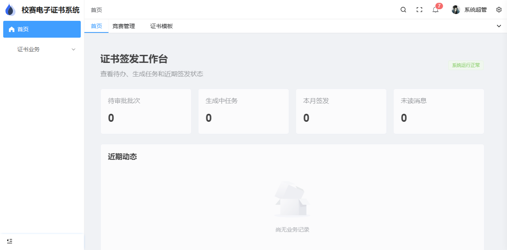
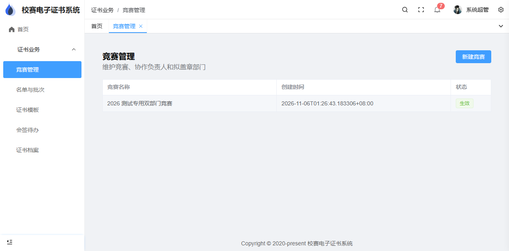
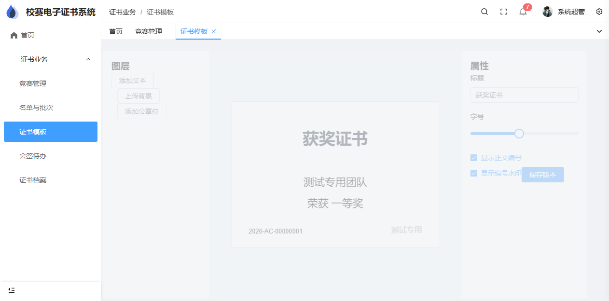

<div align="center">

# AwardCollection

**面向学校竞赛场景的开源电子证书签发与查验系统**

从 Excel 获奖名单导入、跨部门会签，到 PDF 数字签名、图片输出、证书归档与编号查验。

[](LICENSE)
[](https://www.djangoproject.com/)
[](https://vuejs.org/)
[](https://www.typescriptlang.org/)
[](https://docs.docker.com/compose/)

[功能概览](#功能概览) · [快速开始](#快速开始) · [文档](#项目文档) · [贡献](CONTRIBUTING.md) · [English](#english)

</div>



> [!IMPORTANT]
> AwardCollection 目前处于首版开发阶段，尚未发布稳定版本。核心数据模型、Excel 导入、部门会签约束、唯一编号和多签名 PDF 已具备原型与自动化测试，但作废/应急流程、批量 ZIP、限流、完整管理界面和 5000 张规模验收仍在推进。请先阅读[实现状态](docs/implementation-status.md)，不要直接用于正式签发。

## 为什么做这个项目

校内竞赛证书通常涉及负责人填报、多个部门审核与盖章、批量排版、文件发放和事后查验。依靠表格、聊天记录和人工盖章容易出现版本错用、重复编号、审批遗漏以及历史文件不可追溯等问题。

AwardCollection 尝试把这些环节放进一条可审计的工作流：

```text
创建竞赛 -> 导入团队名单 -> 排版检查 -> 冻结批次版本
        -> 多部门并行会签 -> 后台自动生成 -> PDF 增量签名
        -> PDF / PNG 归档与下载 -> 按证书编号查验
```

## 功能概览

### 名单与协作

- 团队证书，一支团队对应一张证书。
- 统一 XLSX 模板导入，提供行号和字段级错误信息。
- 一个负责人可关联多个部门，一项竞赛可配置多位负责人。
- 奖项名称允许自由填写，不受竞赛预设值限制。

### 审批与一致性

- 获奖名单整批提交，多部门并行会签。
- 提交人和直接修改人员需要回避日常审批。
- 数据、模板、公章和输出设置在提交时形成版本快照。
- 最后一项批准在事务中创建唯一生成任务，避免重复签发。

### 模板与签发

- 基于 Pure Admin 的可视化模板编辑界面。
- 支持背景、文本、公章位、正文编号和编号水印设置。
- 中文字体随容器部署，支持长文本换行与字号适配验证。
- 使用 pyHanko 追加多部门 PDF 增量签名，同时输出 PNG。
- 全校唯一证书编号；任务重试不重新分配编号。

### 查验与运维

- 访客使用一次性服务端验证码按编号查验。
- 公开结果采用字段白名单和成员姓名脱敏。
- 原始公章、签名私钥与正式证书通过鉴权接口访问。
- 提供 Docker Compose、健康检查、本机备份与隔离恢复脚本。

## 界面预览

| 竞赛管理 | 模板编辑器 |
| --- | --- |
|  |  |

## 技术架构

```text
Browser
  |
  v
Nginx / Pure Admin (Vue 3 + TypeScript + Element Plus)
  |
  +---- /api ----> Django 5.2 LTS + Django REST Framework
                        |
                        +---- PostgreSQL
                        |
                        +---- persistent task table <---- Worker
                                                          |
                                                          +---- openpyxl
                                                          +---- ReportLab / PyMuPDF
                                                          +---- pyHanko
```

| 层次 | 主要技术 |
| --- | --- |
| Web UI | Pure Admin Thin 6.2.0、Vue 3、TypeScript、Element Plus |
| API | Python 3.12、Django 5.2 LTS、Django REST Framework |
| 数据 | PostgreSQL、Django ORM、数据库持久化任务与租约 |
| 文件 | openpyxl、ReportLab、PyMuPDF、pyHanko |
| 部署 | Nginx、Gunicorn、Docker Compose |

Pure Admin Thin 基于上游提交 `f0ff132561ab684bb78379239adf29f9a38ac7f1`，其 MIT 许可保留在 [frontend/LICENSE](frontend/LICENSE)。

## 快速开始

### 环境要求

- Python 3.12+
- Node.js 20.19+ 或 22.13+
- pnpm 9+
- PostgreSQL 17（完整环境）
- Docker Engine 与 Docker Compose（推荐）

### Docker Compose

```bash
git clone https://github.com/ScyPolit/AwardCollection.git
cd AwardCollection
cp .env.example .env
mkdir -p secrets
printf '%s' 'replace-with-a-random-password' > secrets/db_password.txt
docker compose up -d --build
```

启动前请修改 `.env` 中的数据库密码、`DJANGO_SECRET_KEY` 和 `SIGNING_KEY_PASSWORD`，并确保 `POSTGRES_PASSWORD` 与 `secrets/db_password.txt` 一致。默认入口为 `http://localhost:18080`。

初始化明显标记的测试数据：

```bash
docker compose exec api python manage.py seed_demo --password '<独立测试密码>'
```

> [!CAUTION]
> `seed_demo` 只用于开发和验收。生成的部门、公章、签名证书和证书背景均为“测试专用”，不得用于正式签发。

### 本地开发

后端：

```powershell
python -m venv .venv
.\.venv\Scripts\pip install -r backend\requirements.txt
.\.venv\Scripts\python backend\manage.py migrate
.\.venv\Scripts\python backend\manage.py runserver 127.0.0.1:8000
```

前端：

```powershell
pnpm --dir frontend install --frozen-lockfile
pnpm --dir frontend dev
```

开发入口默认为 `http://127.0.0.1:8848`，Vite 会将 `/api` 代理到 Django。

## 测试

```powershell
.\.venv\Scripts\python backend\manage.py check
.\.venv\Scripts\python backend\manage.py makemigrations --check --dry-run
.\.venv\Scripts\python backend\manage.py test awards
pnpm --dir frontend typecheck
pnpm --dir frontend build
docker compose config --quiet
```

当前自动化测试覆盖 Excel 模板往返、审批回避、两部门会签唯一任务、全局编号唯一性，以及包含两个增量签名的真实 PDF/PNG 生成。详细证据见[测试报告](artifacts/first-release/test-report.md)。

## 项目文档

| 文档 | 内容 |
| --- | --- |
| [需求说明](docs/requirements.md) | 业务规则、角色、数据范围与首期边界 |
| [技术方案](docs/technical-plan.md) | 架构、数据模型、可靠任务与签名方案 |
| [开发路线](docs/roadmap.md) | M0-M7 里程碑和 A01-A30 验收场景 |
| [部署说明](docs/deployment.md) | Compose、配置、升级、备份与恢复 |
| [实现状态](docs/implementation-status.md) | 已实现能力、真实测试结果与剩余缺口 |

## 安全说明

- 不要提交 `.env`、数据库密码、签名私钥、正式公章或生产证书。
- 自签 PDF 的数学签名有效不代表签署身份受公共 CA 信任；部署方需要自行管理信任根。
- 正式 HTTPS、异机备份和密钥托管必须由部署单位结合自身基础设施完成。
- 发现安全问题时，请按照 [SECURITY.md](SECURITY.md) 私下报告，不要直接公开敏感细节。

## 路线图

- 完成名单退回、直接修改、新版本重审和完整管理界面。
- 完成公章上传、模板保存/复制、批量 ZIP 下载和站内通知。
- 完成作废会签、超管应急操作、密码复核和登录失败限制。
- 增加查询限流、PostgreSQL 并发测试、worker 中止恢复测试。
- 完成 5000 支团队真实生成、容器重建和隔离恢复演练。

完整任务拆分见 [docs/roadmap.md](docs/roadmap.md)。

## 参与贡献

Issue、文档改进、测试用例和 Pull Request 都很欢迎。开始前请阅读 [CONTRIBUTING.md](CONTRIBUTING.md)。涉及审批、签名、编号或权限模型的变更，请同时补充自动化测试并说明业务规则影响。

## 许可证

本项目以 [MIT License](LICENSE) 开源。第三方依赖与上游模板保留各自许可证和版权声明。

## English

AwardCollection is an open-source electronic certificate issuance and verification system for school competitions. It covers Excel roster import, multi-department approval, visual certificate templates, globally unique certificate numbers, incremental PDF signatures, PNG output, protected downloads, and number-based public verification.

The project is currently under active first-release development and is **not production-ready**. See [Implementation Status](docs/implementation-status.md) for verified capabilities and known gaps. Contributions are welcome through issues and pull requests.
