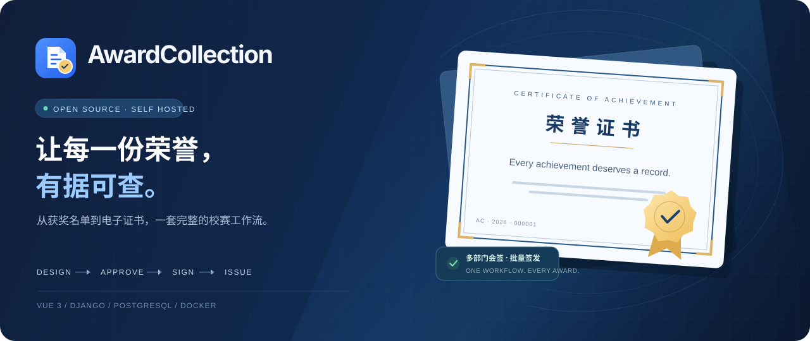
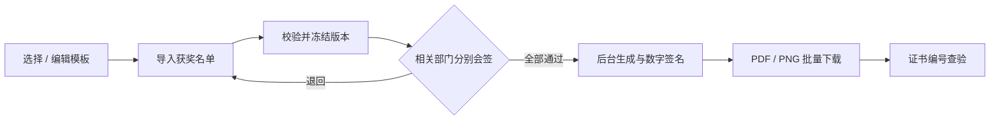
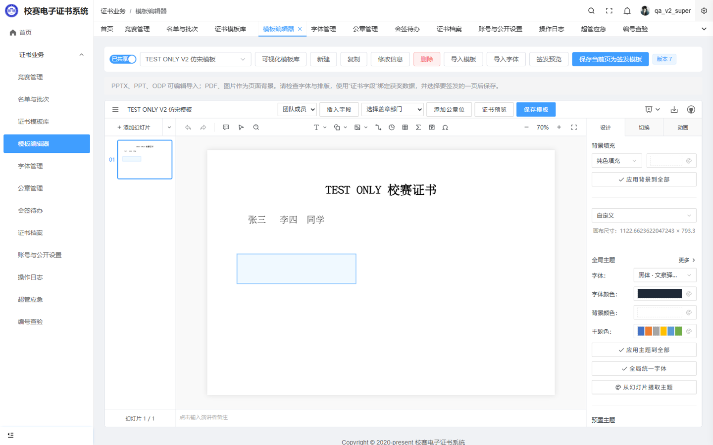
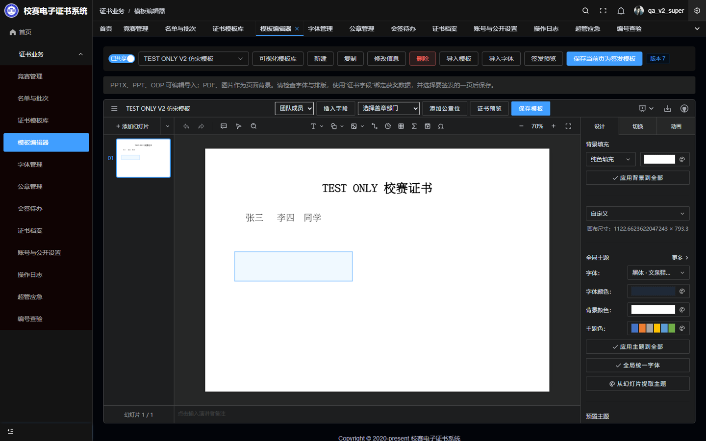
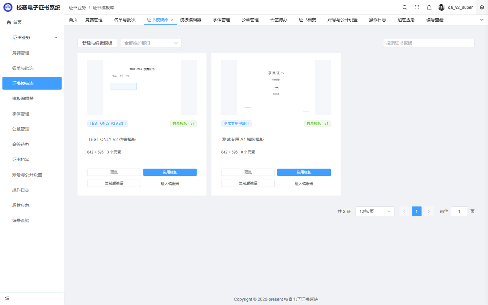
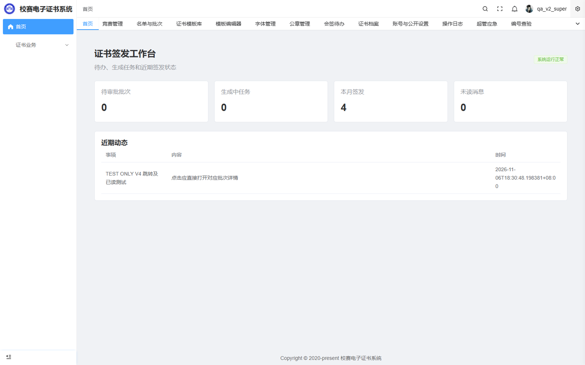

<div align="center">



# AwardCollection · 校赛电子证书系统

**把设计、名单、会签与签发，连成一条完整的工作流。**

面向学校竞赛管理部门的自托管平台：在线编辑证书，多部门协同审批，批量生成带签名的 PDF 与 PNG。

[](https://vuejs.org/)
[](https://www.djangoproject.com/)
[](https://www.postgresql.org/)
[](compose.yaml)
[](#许可证与致谢)

[界面预览](#界面预览) · [功能亮点](#功能亮点) · [快速部署](#快速部署) · [文档](#文档) · [参与贡献](CONTRIBUTING.md)

</div>

## 为什么做这个项目

获奖名单在表格里，证书在设计软件里，公章需要逐个部门确认，最后还要逐张导出。AwardCollection 将这些步骤放进同一个系统：负责人提交名单，相关部门完成会签，后台统一生成证书，领取时按证书编号核对记录。

系统运行在自己的服务器上。首期不依赖付费签章、验证码、云素材或 AI 服务；服务器、存储和域名等基础设施由部署方提供。

## 功能亮点

| | 能力 | 已实现的体验 |
| :---: | --- | --- |
| 🖼️ | **像编辑幻灯片一样设计证书** | 集成 PPTist 原生编辑器，支持富文本、首行缩进、空格、形状、图片、表格、图层、拖拽缩放、对齐与撤销 |
| 📚 | **可视化模板库** | 卡片预览、复制编辑、共享选用、历史版本；背景、字体、公章位与证书字段可调整 |
| 📥 | **导入现有设计** | PPTX、PPT、ODP、PPTist / JSON；PDF、PNG、JPG 可作为页面背景 |
| 🤝 | **多部门会签** | 每个盖章部门分别审批，全部通过才进入生成；保留意见、版本与审批记录 |
| 🏅 | **批量生成与下载** | Excel 导入、校验与预检；PDF / PNG 可选；后台任务显示进度，支持单张与整批下载 |
| 🔔 | **实时协作提醒** | 消息弹出、菜单红点、已读同步，点击通知进入对应业务详情 |
| 🔤 | **中文字体与部门公章** | 登录用户可导入授权字体；超管维护字体库，部门独立维护公章；生成前校验字体与内容 |
| 🔎 | **编号查验与留痕** | 唯一证书编号、可配置公开字段和姓名脱敏、作废状态、操作日志及文件完整性检查 |

### 三种角色，各自有清晰的工作范围

| 角色 | 主要职责 |
| --- | --- |
| **超级管理员** | 全局维护、账号与部门管理、字体和模板管理、竞赛启停、审计；继承部门管理员能力 |
| **部门管理员** | 在授权范围内维护账号和素材、管理本部门公章、审批需要本部门盖章的批次 |
| **竞赛负责人** | 创建竞赛、邀请协作、按模板上传获奖名单、提交会签、查看进度并下载证书；账号无需绑定部门 |



## 界面预览

以下为真实系统截图，使用虚构验收数据；证书画布与学校标识可由部署方按授权替换。

<table>
  <tr>
    <td width="50%"><br /><strong>证书编辑器</strong><br />熟悉的幻灯片编辑方式，直接绑定获奖字段。</td>
    <td width="50%"><br /><strong>深色模式</strong><br />编辑面板随主题切换，证书本身保持原色。</td>
  </tr>
  <tr>
    <td><br /><strong>可视化模板库</strong><br />先看效果，再选用或复制修改。</td>
    <td><br /><strong>签发工作台</strong><br />集中查看会签待办、生成任务和消息。</td>
  </tr>
</table>

## 快速部署

使用 Linux 上的 Docker Engine 与 Docker Compose 插件，首次初始化工具需要 Python 3。首次构建会下载镜像、依赖与字体，请保持网络可用。Windows / macOS 可通过 Docker Desktop 的 Linux 容器运行。

```bash
git clone https://github.com/ScyPolit/AwardCollection.git
cd AwardCollection

# 本机体验；在服务器上部署时，将 localhost 换成服务器 IP 或域名。
python3 deploy/init_env.py --host localhost

docker compose up -d --build
docker compose ps

# 自行设置超管账号与密码；项目不提供默认管理口令。
docker compose exec api python manage.py createsuperuser
```

打开 **https://localhost:18443**。初始化工具会生成独立随机密钥和数据库口令，已有配置时拒绝覆盖。HTTP `18080` 自动跳转到 HTTPS；端口可通过初始化工具参数或 `.env` 配置。

> 默认生成自签 HTTPS 证书，浏览器会提示尚未信任。首次访问应通过可信渠道核对证书；正式部署可替换为本单位认可的证书。HTTPS 证书与证书 PDF 的部门签名证书是两种不同用途的证书。

登录后，依次创建 **部门与账号 → 上传公章 → 建立并发布模板 → 创建竞赛 → 导入名单并提交会签**。首次安装为空系统，不自动创建演示账号或测试业务。

<details>
<summary><strong>部署前还需要知道什么？</strong></summary>

- **服务器地址：** `--host` 同时配置访问地址、允许的 Host 与 CSRF 来源。后续更改域名或端口时，需要同步更新 `.env`，并检查 HTTPS 证书的域名覆盖范围。
- **数据持久化：** 数据库、证书素材、备份与 TLS 文件分别存储在命名卷中。更新时保留卷；`docker compose down -v` 会删除数据。
- **初始化方式：** `createsuperuser` 用于真实安装。仓库中的测试初始化和一次性清理命令属于验收工具，不应在正式业务中直接执行。
- **备份：** 数据库、媒体文件、私密配置与签名密钥应一起备份，并验证恢复。默认同机备份不能替代异机灾备。
- **修改学校标识：** 应用实例使用学校素材，替换前请确认有权使用。README 的项目 Logo 位于 [docs/brand](docs/brand)。
- **运行成本：** 无强制付费接口；服务器、磁盘、网络及运维资源仍需自行准备。

完整配置、升级、备份与恢复步骤见 [部署文档](docs/deployment.md)。已有生产实例应先备份，再按固定提交升级。

</details>

## 技术结构

| 层 | 实现 |
| --- | --- |
| 管理界面 | Vue 3 · TypeScript · Pure Admin · Element Plus |
| 模板编辑 | PPTist 独立子应用 · 富文本与原生幻灯片渲染 |
| 业务服务 | Django · Django REST Framework · ASGI · SSE 实时事件 |
| 数据存储 | PostgreSQL · 持久化媒体卷 · 版本快照与审计记录 |
| 证书生成 | 后台 Worker · Chromium 渲染 · pyHanko PDF 签名 · PNG 输出 |
| 文件转换 | 隔离运行的 LibreOffice 转换服务 |
| 部署入口 | Docker Compose · Nginx · HTTPS |

```text
AwardCollection/
├── backend/                 Django 业务、会签、签名与任务
├── frontend/                Pure Admin 管理界面
│   └── ppt-editor/          PPTist 编辑器与证书桥接
├── converter/               隔离的 Office 转换服务
├── deploy/                  配置初始化、升级、备份与恢复
├── docs/                    需求、方案、品牌与部署文档
└── compose.yaml             完整容器编排
```

## 准确性与安全边界

会签绑定冻结的名单、模板和公章版本，签发前校验快照完整性；已签发记录通过修订、作废等业务流程处理。上传文件经过格式与大小限制，转换服务限制网络及系统资源，证书文件按摘要校验，并保留操作审计。

这些措施用于降低风险，**不构成“绝对安全”或已通过安全等级认证的声明**。正式上线仍需结合访问控制、补丁管理、监控、异机备份和独立安全评估。漏洞报告方式见 [SECURITY.md](SECURITY.md)，具体实现与已知边界见 [安全复核记录](docs/security-review-v4.md)。

### 当前范围

- 首期以**团队证书、校内管理和证书编号查验**为主。
- 自签 PDF 可用于完整性验证；签名身份是否可信，取决于学校对证书及信任链的管理。**PNG 不携带 PDF 数字签名。**
- 常见 PPTX 文字和图形可编辑；复杂 Office 特效、字体和版式需要导入后预览，不能保证与 PowerPoint 完全一致。
- 独立防伪体系、学生自助领取、个人证书、统一身份认证及外部 CA 签章接入列入 [后续计划](docs/roadmap.md)。

## 文档

| 想了解什么 | 从这里开始 |
| --- | --- |
| 安装、配置与运维 | [部署指南](docs/deployment.md) · [部署脚本](deploy/README.md) |
| 功能与业务规则 | [需求说明](docs/requirements.md) · [技术方案](docs/technical-plan.md) |
| 编辑器与导入格式 | [PPT 编辑器选型和集成说明](docs/ppt-editor-assessment.md) |
| 验收与风险边界 | [实现状态](docs/implementation-status.md) · [安全复核](docs/security-review-v4.md) |
| 开发与贡献 | [贡献指南](CONTRIBUTING.md) · [安全报告](SECURITY.md) |
| 品牌与第三方许可 | [Logo 素材](docs/brand/README.md) · [第三方组件说明](THIRD_PARTY_NOTICES.md) |

## 许可证与致谢

本仓库原创业务代码使用 [MIT License](LICENSE)。内置的修改版 **PPTist 使用 [AGPL-3.0](frontend/ppt-editor/LICENSE)**，保留其许可、版权及 [修改说明](frontend/ppt-editor/MODIFICATIONS.md)，并提供相应源代码。**整套发行物不能简单视为全部采用 MIT**；部署、修改与再分发时请同时遵守所含组件的许可要求。

感谢 [Pure Admin](https://github.com/pure-admin/pure-admin-thin)、[PPTist](https://github.com/pipipi-pikachu/PPTist)、[Django](https://github.com/django/django)、[pyHanko](https://github.com/MatthiasValvekens/pyHanko) 及其他开源项目。字体、校徽、公章和上传素材具有各自的授权范围，详见 [第三方组件与素材说明](THIRD_PARTY_NOTICES.md)。

<div align="center">

<br />


**让荣誉被妥善记录，让签发更有秩序。**

[报告问题](https://github.com/ScyPolit/AwardCollection/issues) · [提交改进](https://github.com/ScyPolit/AwardCollection/pulls) · [查看源码](https://github.com/ScyPolit/AwardCollection)

</div>
