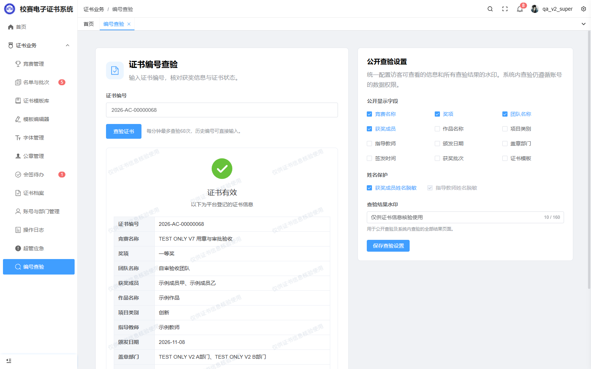
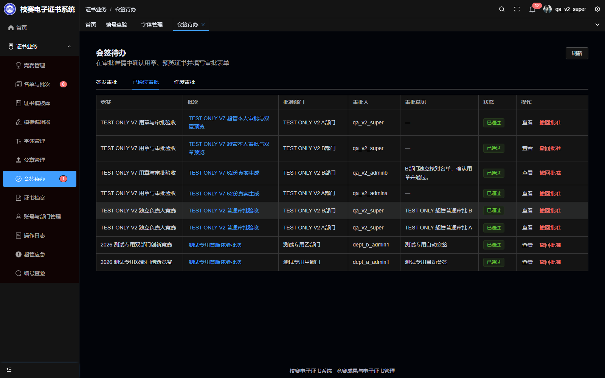
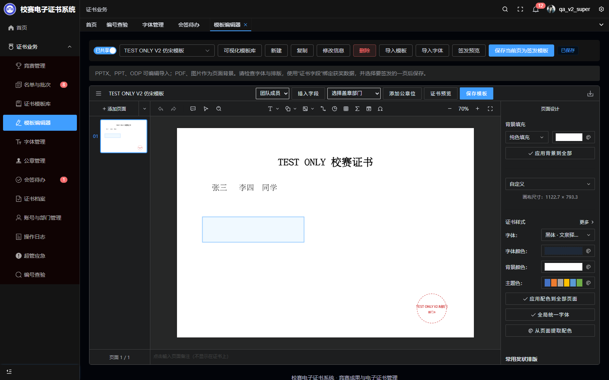
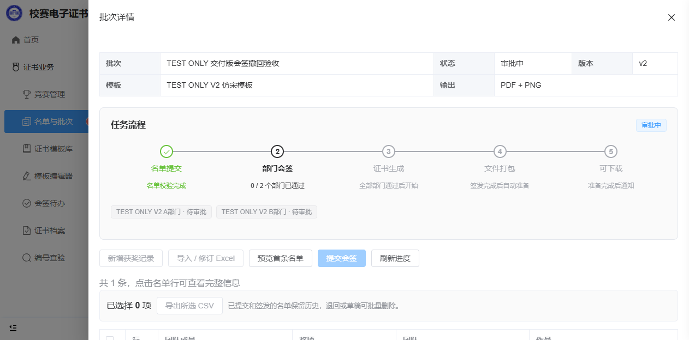
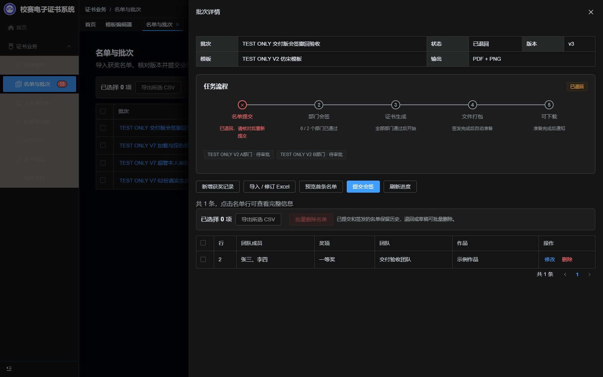
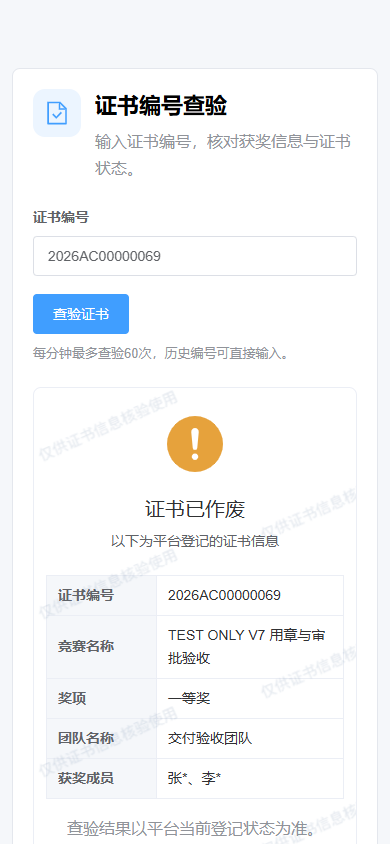
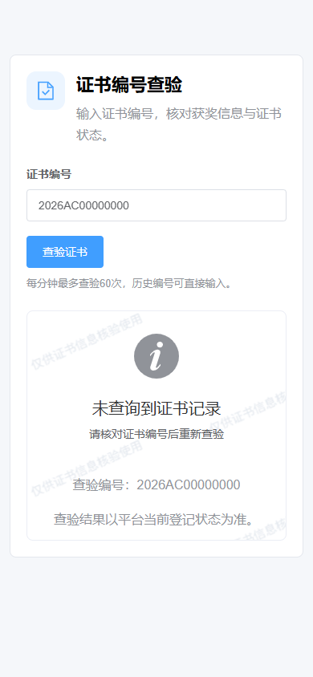

# 2026-11-08 交付版验收

## 功能

- 新编号采用 `2026AC00000001`；原证书不改写，查验兼容带横线与紧凑输入。
- 查验取消验证码。公开与内部查验共享每个来源 IP 滚动60秒60次限额；错误、未找到的请求也计数，超限返回429与重试时间。
- 超管在编号查验中配置12类公开信息、获奖成员/教师姓名脱敏和结果水印；内部及未找到结果同样有水印。
- 华文行楷、宋体默认在前；超管可置顶、上移、下移及保存/恢复字体顺序。负责人可以编辑共享模板、导入字体、添加119×119公章位；实际用章仍由有权限的部门管理员选择。
- 页面状态、详情和日志采用中文。移除运行界面中的 Pure Admin 品牌链接，保留依赖名称和必要许可声明。
- 批次任务以名单提交、部门会签、证书生成、文件打包、可下载五步展示。提交时及提交后禁用Excel导入和名单编辑。
- 提交时复用预检浏览器准备首张PDF与缩略图，持久保存。正式生成路径及配置不作提速调整。
- 各角色会签待办增加“已通过审批”。负责人仅查看；部门管理员可撤回本部门批准，超管可撤回任一部门。填写原因并二次确认后，目标修订已签发证书立即作废，旧任务停止发布，创建干净的退回修订；原件、原审批人、意见及操作记录保留。历史档案仍能准备受权限约束的原件下载包。

## 本地验证

完整后端133项：132通过，1项PostgreSQL并发用例在SQLite跳过；该项已在下述目标PostgreSQL回归通过。前端主应用与编辑器类型检查、完整生产构建通过。

浏览器实际创建虚构批次，负责人编辑共享模板并添加两个119×119公章位，提交时按钮即变灰，审批端首次打开已显示640×453样张。两部门批准后真实生成一张新格式证书，再从“已通过审批”撤回；公共查验立即显示作废，PDF/PNG摘要均未变化。负责人页面通过实时事件显示退回，无需手动刷新。字体排序保存/恢复、菜单红点居中、深色编辑器和流程、390像素手机查验脱敏/水印均检查。详见 [浏览器指标](local-browser.json)。

提交预检的合成300行测量为145.9ms→46.1ms；仅说明该次页面检查的结果，不代表整个提交请求或正式生成的固定提速。缺字与溢出报错和原逐行检查一致，见 [测量](submission-preflight.json)。

## 生产数据保护与发布

发布前只读盘点：901份已发布证书，12个历史模板版本；可选模板仅id=4“标准模板”，最新画布id=21，无测试文字标记。正式账号、模板、公章、字体、证书及编号序列均保留，不执行历史测试数据清理。worker并发1、内存2GiB。见 [发布前盘点](server-before.json)。

目标隔离 PostgreSQL 的133项完整回归已全部通过，耗时48.324秒，未挂载生产媒体，测试库已清理。包含70次并发尝试中仅60次放行的回归。发布前还修复了样张新文件路径超过PostgreSQL 100字符字段上限的问题，并增加长度断言；测试连接也在各线程退出时关闭。api、worker、web、converter 均已运行 `ebc61342a10cd1b8b1b782ca9d5c456435c835d4`，健康接口正常。构建时依赖下载发生超时，最终采用同一提交已成功构建并核对版本标签的镜像完成切换；没有修改锁文件或关闭依赖完整性校验。

备份 `/opt/awardcollection-v1-test/backups/20261108-075100-e3zIfi` 的数据库、媒体、加密配置及加密TLS四项SHA256全部通过，媒体备份9,628,670,949字节。回滚检查点 `/opt/awardcollection-v1-test/rollback/20261108-075052`。原数据库容器创建时间、全部命名卷、901份证书和12个模板历史摘要均保留；三个历史PDF样本文件摘要以及四个已签发修订的完整性校验通过。模板4最新画布21不变，可选模板仍仅“标准模板”。worker仍为2GiB、并发1。详见 [发布核验](production-postcheck.json)、[发布后盘点](server-after.json)。

线上浏览器已核验原会话及刷新前端后的登录有效、12项公开设置、华文行楷/宋体优先、已通过审批标签及撤回按钮、无上游品牌链接。手机公开查验无需验证码，未找到结果有水印，无页面横向溢出。已有841,209,352字节下载包的HEAD返回200；Range返回206，实际仅读取32字节，没有将整包装入浏览器内存。没有在正式证书上演练撤回或签发。详见 [线上浏览器核验](production-browser.json)。

## 截图

